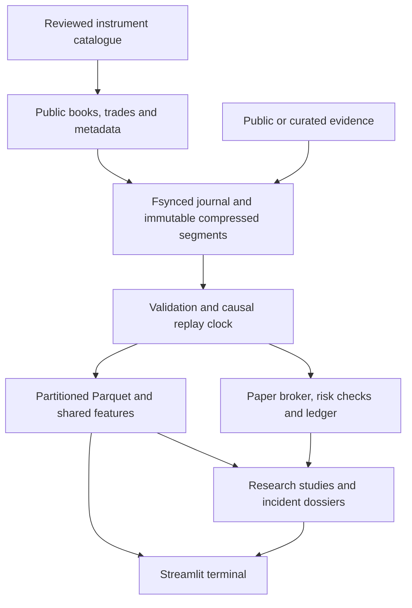

# Prediction Market Lab

**How do prediction markets incorporate information, and which apparent opportunities survive liquidity, fees and execution constraints?**

A Python research application for football prediction markets: public-data recording, causal replay, microstructure studies, evidence dossiers and fully funded paper execution. The primary universe is EPL and Champions League regulation-time 1X2, with a small macro/politics comparison sample.

This is a fresh independent implementation. No former-employer code, credentials, configuration or news archives are included. There is **no live-trading integration**.

## Run the demonstration

Requires Python 3.12 and [uv](https://docs.astral.sh/uv/). Resolved packages are pinned in `uv.lock`; the official public SDK is explicitly pinned to `polymarket-client==0.10.0`.

```sh
uv sync --locked --no-editable
uv run --locked --no-editable pml demo
uv run --locked --no-editable pml dashboard --workspace data/demo
```

Open the local dashboard at `http://127.0.0.1:8501`. The standalone report is `data/demo/research/index.html`. The full demo creates eight synthetic events, eleven execution scenarios, three research memos, incident dossiers and a verified backup restoration. `pml demo --quick --out data/quick` runs one paper scenario. Existing run directories are never overwritten.

**The demo is synthetic.** Its prices and outcomes are not a calibrated simulation and establish no trading edge. Observed, synthetic, derived and simulated records carry separate provenance fields.

The application can be exercised offline after dependency installation. Live public connectivity was verified on 14 October 2026 with a one-hour EPL recording; rule reviews for that recording still await researcher sign-off. The **72-hour pilot plus matchday** and **eight weeks of prospective recording** are outstanding empirical milestones. See [delivery status](docs/delivery-status.md).

## Inspect the complete chain

1. **Universe and coverage:** recorded assets, reviewed rules, versioned parameters and usable asset-time.
2. **Fixture replay:** a receipt-time cursor through prices, depth checkpoints and received evidence.
3. **Microstructure:** liquidity by event phase, chronological model validation and information-shock windows.
4. **Incidents:** measured moves, then-known evidence, uncertainty and separately labeled follow-up.
5. **Paper portfolio and health:** orders, rejections, cash/inventory, latency/queue scenarios and gaps.



## Research companions

| Study | Reproducible work | Evidence boundary |
|---|---|---|
| [Liquidity and price discovery](notebooks/01_liquidity.ipynb) | Midpoint/weighted-midpoint baselines, regularized OFI forecasts, imbalance logistic regression; 10/60/300-second labels | Future labels never enter strategies; validation is grouped by event and purged |
| [Information and liquidity shocks](notebooks/02_information_shocks.ipynb) | Kickoff and **receipt** of score updates; spread/depth/repricing and local comparison windows | Descriptive association, not exact goal timing or causal attribution |
| [Execution and liquidity provision](notebooks/03_execution.ipynb) | Taker, static and inventory-skew strategies; sensitivity and full ledger | Passive fills are scenarios, not reconstructed queues or guaranteed bounds |

```sh
uv run --locked --no-editable python scripts/run_notebooks.py --workspace data/demo
```

Executed copies go to `artifacts/notebooks/`. Notebooks call the same calculations as the CLI and terminal. Read the [research protocol](docs/research-protocol.md) before interpreting results.

## Optional live evidence and model summaries

Web search (Exa), match events (API-Football) and model summaries (OpenAI) are optional and run separately from the market collector. Copy `.env.example` to `.env`, add only the keys you use, and keep the file local; `.env` is ignored by Git.

```sh
cp .env.example .env && chmod 600 .env
# Timed searches per fixture (24 h, 2 h and 1 h before kickoff, every 15 min in play, after the match)
uv run --locked --no-editable --env-file .env pml evidence-watch --watchlist data/watchlist.json --out data/evidence --until 2026-10-18T22:00:00Z --budget-usd 20
# Propose API-Football fixture IDs; fill reviewed_by before passing --mapping to evidence-watch
uv run --locked --no-editable --env-file .env pml football-map --watchlist data/watchlist.json --season 2026 --out data/football-map.json --spend-ledger data/evidence/spend.jsonl
# Incident explanations from evidence retrieved before each move
uv run --locked --no-editable --env-file .env pml research --run data/runs/window-01 --out data/research/window-01 --evidence data/evidence/evidence.json --summarizer openai --spend-ledger data/evidence/spend.jsonl
```

Every paid call is checked against one append-only spend ledger before it is made; a call that could exceed `--budget-usd` is refused. Each evidence item keeps the time it was first retrieved, so an incident only sees items retrieved before it. Search engines cannot be queried as of a past time: evidence for a match must be collected while it happens. Model output is a candidate explanation citing evidence IDs, marked for researcher review, and falls back to the template on any failure. API-Football's free plan refuses current-season lookups by league or date but serves live fixtures, so `evidence-watch` polls live EPL fixtures every six minutes during match windows and links them by exact team names and kickoff (or a reviewed `--mapping`). Event minutes are match time, so they label what happened, not when prices could first react.

## Pre-match forecasts against the market

A forecasting track asks a second question: can an ensemble of diverse forecasters price EPL 1X2 outcomes better than Polymarket before kickoff? Members are chosen to differ in kind, following Aitchison et al., [Diversity is the Strength of the AI Crowd](https://arxiv.org/abs/2606.29661) (2026): an Elo rating model, a time-weighted Poisson goal model (both on football-data.co.uk results since 2014, Premier League and Championship), and six language models from six vendors via OpenRouter reading the retrieved evidence, three samples each. The full protocol, expected results and limitations are in [docs/forecasting.md](docs/forecasting.md). They are combined by two pre-registered pools, one weighing members equally and one weighing the statistical and language-model families equally, until enough frozen forecasts exist to fit weights out of sample.

```sh
# Walk-forward check of the statistical members against bookmaker closing odds
uv run --locked --no-editable pml forecast-backtest --out data/forecast-backtest.json
# Freeze forecasts 24 h and 1 h before each kickoff, each with a Polymarket book snapshot
uv run --locked --no-editable --env-file .env pml forecast-watch --watchlist data/watchlist.json --evidence data/evidence/evidence.json --out data/forecasts.jsonl --spend-ledger data/evidence/spend.jsonl --until 2026-10-18T22:00:00Z
# After results are published: scores, diversity, leave-one-out and paper trades
uv run --locked --no-editable pml forecast-evaluate --forecasts data/forecasts.jsonl --out data/forecast-evaluation.json
```

Each forecast is appended to a hash-chained log with the market snapshot taken at the same moment, so nothing can be revised after kickoff. The evaluator is deterministic: ranked probability score, Brier, log loss and calibration error; paired bootstrap intervals against the market midpoint; pairwise Jensen-Shannon diversity; leave-one-out member value; and $10 paper trades at the recorded best ask when the ensemble clears it by three points, net of the taker fee. Language-model members are only evaluated prospectively, because their training data overlaps any historical season. On 2022–2025 the Elo model's RPS was 0.2018 against 0.1947 for bookmaker closing odds over 1,520 matches: the market benchmark is strong, and a weekend of six matches cannot show an edge either way.

## Start prospective collection

Discovery is read-only. Use exact sport abbreviations from the current catalogue; do not guess IDs or infer contracts from titles.

```sh
uv run --locked --no-editable pml sports --out data/sports.json
uv run --locked --no-editable pml discover --sport <verified-abbreviation> --pages 2 --out data/discovery.json
uv run --locked --no-editable pml review-template --discovery data/discovery.json --out data/reviews.json
# Review complete home/draw/away YES+NO families and fill the review fields.
uv run --locked --no-editable pml catalog-build --discovery data/discovery.json --reviews data/reviews.json --out data/contracts.json
uv run --locked --no-editable pml select --contracts data/contracts.json --out data/watchlist.json
uv run --locked --no-editable pml --config config/default.toml collect --watchlist data/watchlist.json --out data/live --seconds 259200
```

Reviews bind identifiers to a hash of the rule text. Changed rules invalidate approval. Selection is capped at ten complete football families, six binary comparison conditions and 80 assets. Decisions are saved with the watchlist. Selection is fixed for each session: refresh the reviewed catalogue and start a new session as fixtures roll. Retain quiet and completed sessions in research history.

Collectors preserve REST reconciliation snapshots without claiming that concurrent REST/WebSocket responses establish lossless continuity. Reconnects require a fresh stream snapshot. Books are usable, recovering or degraded; a quiet quote differs from a silent feed.

## Analyze a recorded window

```sh
uv run --locked --no-editable pml replay --capture data/live --out data/runs/window-01 --from 2026-10-01T12:00:00Z --until 2026-10-01T14:00:00Z
uv run --locked --no-editable pml paper --capture data/live --out data/paper/window-01 --strategy inventory --latency-ms 250
uv run --locked --no-editable pml research --run data/runs/window-01 --paper-root data/paper --out data/research/window-01 --evidence data/evidence.json
```

Replay warms up from earlier observations, then retains the selected window. It defaults to a 250,000-record memory bound; select shorter windows or explicitly raise `--max-records`. Parquet is partitioned by receipt date. DuckDB uses independent in-memory connections against committed files. Each paper run owns its output directory.

Paper defaults: $10,000 virtual cash, $100 event risk, $1,000 portfolio risk, five-share orders and 250 ms additional latency. Takers also incur the captured venue delay. Missing fee/delay/tick/size metadata prevents cost-adjusted execution. All inventory must be purchased; rewards and rebates are zero.

## Operations and verification

```sh
sh scripts/check.sh
uv run --locked --no-editable pml verify data/live
uv run --locked --no-editable pml backup-check data/live
uv run --locked --no-editable pml health data/live
uv run --locked --no-editable pml pilot-report data/runs/window-01
```

CI exercises offline tests, a demo and notebooks. Docker Compose and systemd examples are provided but not automatically deployed. The [runbook](docs/runbook.md) covers restart behavior, offsite backups, matchday qualification and cost projections.

Further reading: [architecture](docs/architecture.md) · [data dictionary](docs/data-dictionary.md) · [source register](docs/sources.md) · [validation record](docs/validation.md) · [delivery status](docs/delivery-status.md) · [forecasting](docs/forecasting.md) · [walkthrough](docs/walkthrough.md).

Future extensions: executable within-event consistency with explicit negative-risk conversions, calibration/resolution economics, reviewed Kalshi contract matching, richer inventory control and independent sports-event feeds. These are separate from the initial research claims.
