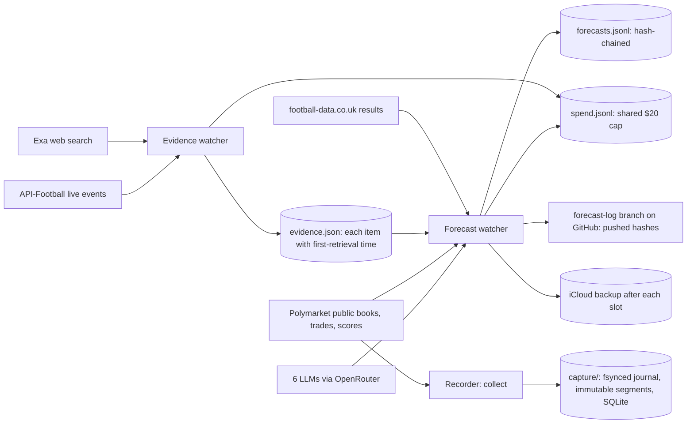

# Project overview

The starting point for understanding this project: what it studies, what is running now, what the current pilot tests, and the methods behind each part. Each section links to the detailed document. State as of 16 October 2026.

## In one paragraph

Prediction Market Lab is a read-only research system for **Polymarket football markets** (English Premier League, regulation-time home/draw/away). It records public order books, trades and scores as they happen, collects the news and match events available at each moment, and asks two questions. First, **how does information enter prices**, and which apparent opportunities survive spread, fees and latency? Second, **can a diverse ensemble of forecasters price match outcomes better than the market** before kickoff? Nothing is traded: there is no wallet, no venue key and no order endpoint. All execution is paper simulation against recorded books.

## The two research tracks

| | Track 1: microstructure | Track 2: forecasting vs the market |
|---|---|---|
| Question | How do prices react to information, and which opportunities survive costs? | Does an ensemble beat the Polymarket price before kickoff? |
| Inputs | Recorded books, trades, scores; evidence retrieved before each move | Historical results, evidence retrieved before each forecast, market book at the same moment |
| Output | Liquidity studies, information-shock windows, paper execution, incident dossiers | Frozen forecasts, scores against the market, diversity, paper trades, closing-line value |
| Detailed protocol | [research-protocol.md](research-protocol.md) | [forecasting.md](forecasting.md) |

Both tracks share one recorder, one evidence store, one spend ledger and one fee model.

## What is running now: the 72-hour pilot

**Window:** 15 Oct 22:35 UTC → 18 Oct 22:35 UTC, on one Mac (charger connected, Polymarket reachable only over a VPN).
**Universe:** six EPL fixtures, each a complete family of three binary markets (home win, draw, away win) with YES and NO tokens, so 36 assets. Rules were reviewed and signed off on 16 October.

| Fixture | Match | Kickoff (UTC) |
|---|---|---|
| `epl-1128425` | Everton – Chelsea | Sat 17 Oct 11:30 |
| `epl-1128431` | Brentford – Liverpool | Sat 17 Oct 14:00 |
| `epl-1128438` | Fulham – Hull City | Sat 17 Oct 14:00 |
| `epl-1128443` | Manchester City – Ipswich Town | Sat 17 Oct 14:00 |
| `epl-1128447` | Newcastle – Aston Villa | Sat 17 Oct 16:30 |
| `epl-1134904` | Brighton – Crystal Palace | Sun 18 Oct 13:00 |

Three independent processes run side by side. Each restarts itself after a crash and resumes from its own files; a failure in one cannot block another.

| Process | What it does | Schedule |
|---|---|---|
| **Recorder** (`pml collect`) | Subscribes to the market and sports WebSockets for the 36 assets, takes REST book snapshots, writes everything to an append-only archive | Continuous for 72 hours |
| **Evidence watcher** (`pml evidence-watch`) | Exa searches per fixture; polls API-Football for live EPL events during match windows | Searches 24 h, 2 h and 1 h before kickoff, every 15 min in play, and after the match |
| **Forecast watcher** (`pml forecast-watch`) | Freezes one ensemble forecast per fixture and slot, with a market snapshot taken at the same moment; backs up research files after each slot | 24 h, 6 h and 1 h before kickoff, plus 10 min (so the 24 h and 1 h slots read that hour's search results) |

Start commands and restart procedure: [runbook: pilot scripts](runbook.md#pilot-scripts).

## What the pilot tests

The pilot is a **qualification run**, not an experiment that can show an edge. Six matches are far too few: detecting a 0.01 difference in ranked probability score needs roughly 220 matches ([forecasting.md: what to expect](forecasting.md#what-to-expect)). It tests whether the system can collect trustworthy data through a real matchday.

**Recorder (pilot gate A, [delivery-status.md](delivery-status.md)):**

- A **72-hour observed span including a matchday**, with every gap recorded rather than filled. `pml pilot-report` reports the span and quality-weighted usable asset-time; elapsed time alone does not pass.
- Books stay usable through kickoff and in-play volatility; disconnects recover through fresh snapshots.
- The **sports-stream join**: whether Polymarket's score feed carries these EPL fixtures and links to them (untested so far, because it has only shown other leagues).
- A **restore test** of the archive (`pml backup-check`) and a **measured storage and cost forecast** from matchday data (`pml budget`).

**Evidence watcher:**

- Searches fire on schedule, and the spend cap holds.
- API-Football live events link to the right fixtures by exact team names and kickoff. This can only be checked once matches start.

**Forecast watcher:**

- Every slot fires before kickoff, with a market snapshot, a frozen record and a pushed hash.
- No forecast reads evidence retrieved after it was made (see "No look-ahead" below).
- The scoring pipeline runs end to end once results are published.

## Methods

### Recording (track 1 foundation)

- **Universe selection.** Complete home/draw/away families only, reviewed against a hash of the rule text; changed rules invalidate approval. Selection is fixed for a session and saved with its reasons.
- **Durability.** Every received message gets a UTC receipt time and local sequence number, is fsynced to a journal, then published as immutable compressed segments with checksums. A torn last line is recoverable; corruption is an error.
- **Book quality.** Each book is usable, recovering or degraded. Reconnects start a new epoch from a fresh snapshot, and no label or feature crosses epochs.

Details: [architecture.md](architecture.md), [data-dictionary.md](data-dictionary.md).

### Replay and microstructure studies (track 1)

- **Causal replay.** A receipt-time clock replays recorded data, so a strategy or study only sees what had arrived by then.
- **Liquidity and price discovery.** Order-flow and queue imbalance features against fixed baselines (no-change midpoint, Ridge, logistic regression), with 10/60/300-second labels. Validation holds out the last 30% of fixtures in time order, with purging and embargo; uncertainty is bootstrapped by event, not by tick.
- **Information shocks.** Windows around scheduled kickoff and around local **receipt** of score updates (not goal time), compared descriptively with earlier windows. These are associations, not causal claims.
- **Incidents.** A move of at least 3 points in 60 seconds triggers a dossier: measured facts, the evidence retrieved before the move, and what is missing. An optional OpenAI summarizer drafts a candidate explanation citing evidence IDs, for researcher review.

Details: [research-protocol.md](research-protocol.md).

### Paper execution (both tracks)

Fully funded virtual account: $10,000 cash, risk limits per event and portfolio, no free inventory and no short selling. Taker orders walk recorded depth after a latency delay; the venue fee `shares × rate × p × (1 − p)` uses the captured rate (5%). Passive fills are scenarios, not reconstructed queues. Results are simulations, not proof of executable profit.

### Forecasting (track 2)

- **Members, chosen to differ in kind** (following [Aitchison et al. 2026](https://arxiv.org/abs/2606.29661)):
  - an **Elo** rating model and a **Poisson goal model**, both fitted on football-data.co.uk results;
  - **six language models from six vendors**, via OpenRouter. Each reads the evidence retrieved before the forecast, with odds sentences removed, and is sampled three times.
- **Pools, fixed before any result:** an equal-weight pool of all eight members, and a pool that weighs the statistical and language-model families equally. Two **market-aware** variants see the market price; they are scored separately and never pooled, so the pools stay independent of their benchmark.
- **Benchmark:** the Polymarket midpoint at the same moment. Bookmaker closing odds and the market at kickoff are further benchmarks.
- **Scoring:**
  - ranked probability score (primary), Brier, log loss and calibration;
  - paired bootstrap intervals against the market;
  - Jensen-Shannon diversity and leave-one-out member value;
  - $10 paper trades at the recorded ask when the ensemble clears it by 3 points, net of fees, plus closing-line value.
- **Backtest so far:** over 1,520 matches, the statistical members are worse than bookmaker closing odds (Elo RPS 0.2018 vs 0.1947). The benchmark is strong.

Details: [forecasting.md](forecasting.md).

## No look-ahead and integrity

The central methodological rule: **nothing may use information that was not available at the time it claims to represent.**

- **Evidence carries its first-retrieval time** (`first_seen`, UTC). Incident dossiers and forecasts only read items retrieved before them; models read nothing retrieved after the forecast time (since commit `4bb31db`). Web search cannot be replayed as of a past date, so evidence must be collected live.
- **Results:** statistical members use match results up to the day before the forecast.
- **Market snapshot first:** the order book is read before any model runs.
- **Forecasts are frozen.** Each record carries the SHA-256 of its content and of the previous record, and the hash is pushed to the `forecast-log` branch on GitHub before kickoff, an external timestamp. Every slot that fires is published, so a missing slot is visible.
- **Late slots are visible.** `scheduled_at` shows when a slot fired late after a restart. The five forecasts frozen before the evidence cutoff are flagged, not excluded ([list and reasoning](forecasting.md#forecasts-frozen-before-the-evidence-cutoff)).
- **Provenance labels** keep observed, synthetic, derived and simulated data apart in every table.

## Operations and safety

- **Spend:** every paid call (Exa, OpenRouter, OpenAI) is checked against one append-only ledger first, and a call that could exceed the $20 cap is refused. About $1 had been spent by 16 Oct 20:00 UTC.
- **Backups:**
  - Forecasts, evidence, spend ledger and watcher state are copied and verified to iCloud Drive after each forecast slot (`PML_BACKUP_DIR`). `pml backup-status` warns when the newest verified copy is too old.
  - The capture is copied with `pml backup` (latest copy: 16 Oct 19:52 UTC).
  - Details: [runbook: backups](runbook.md#automatic-research-backups).
- **Code during the pilot:** every crash-restart rebuilds from the main checkout, so it stays clean and on a tested commit while the pilot runs. Development happens in a separate `git worktree`.
- **Checks before each commit:** `sh scripts/check.sh` runs ruff, mypy and the test suite.

## After the pilot

1. Verify and back up the capture; replay, paper and research on the recorded window; `pml pilot-report`.
2. Once football-data.co.uk publishes the results, run `pml forecast-evaluate` with the capture for closing-line value.
3. Record outcomes in [delivery-status.md](delivery-status.md): which gates passed and what failed.
4. Next empirical milestone: **eight weeks of prospective recording** across rolling fixtures, and more leagues to grow the forecasting sample ([roadmap](forecasting.md#improving-beyond-the-limitations)).

## What results will and will not mean

- The pilot shows whether data collection is trustworthy. It **cannot** show that any forecaster or strategy beats the market.
- The most likely long-run result on liquid EPL markets is an ensemble close to, but not better than, the market. Any edge is more likely in thinner markets.
- Paper results ignore our own market impact and some latency; they bound what might be possible and are not evidence of profit.

## Document map

| Document | Read it for |
|---|---|
| [README](../README.md) | Install, demo and command reference |
| [forecasting.md](forecasting.md) | Track 2 protocol, members, evaluation, limitations, roadmap |
| [research-protocol.md](research-protocol.md) | Track 1 hypotheses, features, validation, execution rules |
| [architecture.md](architecture.md) | Modules, durability, replay timing, storage |
| [data-dictionary.md](data-dictionary.md) | Every dataset, identifier and clock |
| [runbook.md](runbook.md) | Running, restarting, health checks, backups, costs |
| [delivery-status.md](delivery-status.md) | Acceptance gates and what has been verified live |
| [pilot-2026-10-report.md](pilot-2026-10-report.md) | Findings of the 72-hour pilot of 15–18 October 2026 |
| [validation.md](validation.md) | Local verification record |
| [sources.md](sources.md) | External sources and what each is used for |
| [walkthrough.md](walkthrough.md) | Five-minute demonstration script |
| [HANDOFF](../HANDOFF.md) | Short current-state note for whoever picks the project up |
